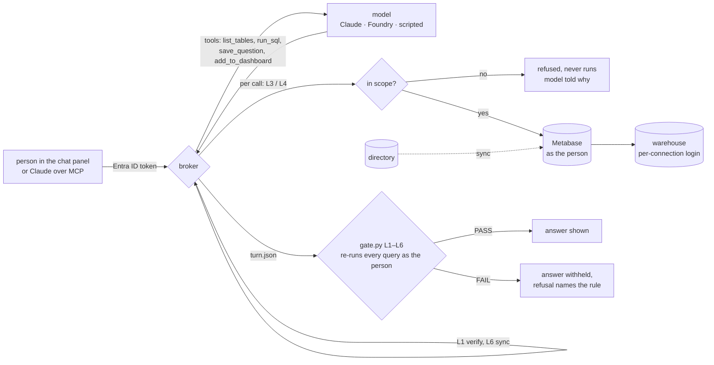

# lens-gate

[](https://github.com/jbisaccia-9/lens-gate/actions/workflows/ci.yml) · [live demo](https://jbisaccia-9.github.io/lens-gate/) · [captured results](RESULTS.md)

**AI on the dashboards, running as the person who asked — and the gate that refuses any answer they couldn't have produced by hand, or that quotes a number no query returned.**

The setup is one a lot of teams are reaching for: a self-hosted Metabase in
front of the warehouse, Claude connected to it over MCP to build and extend
dashboards, and a chat panel beside the dashboards where anyone can ask a
question in plain English and get a chart back — answered by Claude or by an
Azure AI Foundry agent. Directory groups (Entra ID) decide who sees what: a
store lead gets sales and inventory, finance gets the P&L, executives get
everything.

Every way that goes wrong is quiet. The chat panel calls Metabase with one
service key "to keep it simple", so the system prompt is the only thing between
a store lead and the P&L. A join smuggles a finance table onto a sales
connection. The model, asked to "put it on the dashboard", picks the executive
one. The answer quotes every figure correctly and then adds a friendly
projection nobody computed. Someone moved from finance to a store last month;
the directory knows, Metabase doesn't. Each of those is a counterexample here,
and CI asserts that each is refused. On the seeded morning: **5/5 turns pass,
the store lead's finance question is refused before the query runs, 5
dashboard writes land each as the person who asked, the planted access drift
is reported, and 6/6 counterexamples are refused — each for exactly the rule
in its name.**

## Try it without installing anything

The [live demo](https://jbisaccia-9.github.io/lens-gate/) lets you pick one of
six people at Larkmoor Goods, see only the dashboards their access shows, and
ask the demo questions as them: in-scope answers come back with all six checks,
out-of-scope ones are refused with the gate's real reason, and a chart someone
saves appears on their dashboard. It's a replay, not a live system —
`scripts/build_site.py` runs every question as every person (30 turns) through
the real broker and gate, plus the six counterexamples, and inlines the results
into one static page. A test rebuilds it and fails if `docs/index.html` is stale,
so the page can't drift from the code.

## Quickstart (offline — no Docker, no keys)

```bash
pip install git+https://github.com/jbisaccia-9/lens-gate
python -m lensgate seed data                         # fictional 12-store retail chain, dev IdP, Metabase state
python -m lensgate demo data --out out/run           # 5 questions from 4 people through the broker; all graded
python -m lensgate counterexamples out/cx --data data && python -m lensgate check-dir out/cx --data data   # exit 1
```

`python -m lensgate sync data` reports the planted drift (exit 1);
`--apply` fixes it, after which the L6 counterexample clears — L6 is about
the world, not the turn.

## The live stack

```bash
python -m lensgate seed data                         # the warehouse loads ./data on first start
cp .env.example .env                                 # fill in every value; letters and digits only
docker compose up -d                                 # Postgres warehouse + Metabase v0.64.1, both on 127.0.0.1
LENSGATE_MB_ADMIN_EMAIL=... LENSGATE_MB_ADMIN_PASSWORD=... \
  python -m lensgate provision --metabase http://localhost:3000
LENSGATE_MB_ADMIN_EMAIL=... LENSGATE_MB_ADMIN_PASSWORD=... LENSGATE_DEMO_PASSWORD=... \
  python -m lensgate sync data --metabase http://localhost:3000 --apply
python -m lensgate serve data --metabase http://localhost:3000   # chat panel on :8700, Metabase alongside
```

`provision` builds the whole instance from [`policy.yaml`](src/lensgate/config/policy.yaml):
one Metabase database per connection (each its own warehouse login), one group
per role, native-SQL permission on exactly that role's connections, collection
permissions (curate = write), and the static dashboards in
[`dashboards.yaml`](src/lensgate/config/dashboards.yaml). Anonymous tracking
and update checks are off.

Two ways to bring Claude in, both running as you:

```bash
# 1. Metabase's own MCP server (v0.60+): search, explore and query, scoped to your Metabase login.
#    Turn it on under Admin > AI > MCP, then:
claude mcp add --transport http metabase http://localhost:3000/api/mcp

# 2. lens-gate's MCP server: the write tools - save a chart, pin it to a dashboard - behind L1-L4 and L6.
pip install "lens-gate[mcp]"
claude mcp add lens-gate -e LENSGATE_ID_TOKEN=... -e LENSGATE_METABASE_URL=http://localhost:3000 \
  -e LENSGATE_MB_EMAIL=... -e LENSGATE_MB_PASSWORD=... -- python -m lensgate mcp data
```

The chat panel's model is `LENSGATE_PROVIDER`: `scripted` (default, the demo
plans), `anthropic` (Claude via the Messages API) or `foundry` (an Azure AI
Foundry deployment). Install the clients with `pip install "lens-gate[live]"`.

## The split that makes the gate possible

**The person's permissions decide. The model proposes.** The broker that sits
between the chat panel and Metabase holds exactly one kind of credential: the
asking person's own session. Every tool the model calls is checked before it
runs, a refused call never executes, and when the model is finished the whole
turn — token, credential, every query and result, every chart saved, the
answer — is written to `turn.json` and graded by code that shares no objects
with the broker and **re-runs every query itself, as the person**. Only a
passing turn's answer is shown.

| rule | what it refuses |
|---|---|
| L1 identity | a token that doesn't verify (signature, issuer, audience, validity *at the time asked*), or whose groups map to no role; an Entra groups-overage claim (fail closed, never guess) |
| L2 credential | work done under anything but the asking person's own session — an admin key, a service account, a colleague's session |
| L3 read scope | a query on a connection the role isn't granted; a table outside that connection's schemas; anything but one read-only SELECT; any function not on the allowlist |
| L4 write scope | a chart saved, or a dashboard edited, in a collection the role can't curate |
| L5 numbers | a recorded result that differs from re-running it as the person; any number in the answer — or in a saved chart's title — that no verified result (or the question) contains |
| L6 sync | a person whose Metabase groups differ from what their directory groups say today, in either direction |

L1 short-circuits: without a verified person, nothing else is meaningful,
and the report says *not evaluated* rather than piling up failures. L5 is
strict on purpose: 412,330.50 matches a result of 412330.5; 412,331 doesn't,
"$1.79M" doesn't, and neither does 4.2% when the result says 4.17. The
contract that makes that strictness livable is in the system prompt: *compute
in SQL, quote in prose.* The demo plans do exactly that — every percentage in
the answers is a column in a result.

## Three layers, and why the gate is the one that's tested

```
question ─► L3 in the broker ─► Metabase permissions ─► warehouse login ─► rows
            (refuses with a       (group → connection,    (wh_sales has GRANT
             reason, before        collection → curate)     on ref, sales: and
             anything runs)                                  nothing else)
```

A store lead's query for `finance.store_pnl_monthly` on `wh_sales` is refused
by the broker with a sentence a person can read. If the broker were bypassed,
Metabase wouldn't let a store lead run SQL on `wh_finance` at all. If Metabase
were bypassed with an admin key, `wh_sales` still couldn't see the table: the
warehouse login was never granted the schema. The grants are generated from
`policy.yaml` (`lensgate ddl --roles`), and a test fails if
`docker/initdb/02-roles.sh` drifts from it. The offline backend reproduces
both lower layers — a per-connection SQLite session with only that
connection's schemas attached, read-only — so the gate is tested against
something that pushes back.

The warehouse layer is also checked on real Postgres on every push (the
`warehouse` CI job): the shipped init scripts load the seed, all 14 shipped
queries return exactly what the offline backend returns, and every login is
refused every schema it wasn't granted — 16 checks, including the string
smuggle below. Widen one grant and that job fails.

## How it works



## The gate had holes, and probing found them

The first build cleared the seeded morning and all six counterexamples on its
first run, which is evidence about the counterexamples, not the gate. So I
tried to get things past it.

```sql
SELECT query_to_xml('select * from finance.store_pnl_monthly', true, false, '')
```

`PASS`. L3 reads table names after stripping string literals, so it never saw
a table at all — and Postgres will happily run SQL handed to it in a string.
The warehouse login still refuses it (`scripts/pg_check.py` shows that on real
Postgres, in CI — it's what the third layer is for), but the gate's job is to
refuse with a reason *before* anything runs, and it didn't. A denylist would be one function behind forever (`dblink`,
`query_to_xml_and_xmlschema`, the next one), so L3 now refuses any function
not on an allowlist of the ones reporting queries actually use. Both, plus a
schema-qualified `pg_catalog.pg_read_file`, are tests.

`about $1.79M` also passed L5: the number regex backtracked to `$1`, which
the results didn't contain — so it was reported, but as the wrong token. Worse
variants could slip entirely. Numbers with letters glued on (`1.79M`, `3x`,
`5th`) are now always unsourced: abbreviating is rounding with extra steps.

With those fixed and 70 tests passing, I broke each rule on purpose and re-ran
the suite. Two mutations survived: disabling L2's credential-kind check, and disabling L4's dashboard
check. Both were masked — the shared-key counterexample also trips the
service-principal list, and the write counterexample also saves into the wrong
collection. Each now has a test that isolates it. A counterexample that fails
for two reasons is evidence about one of them.

## The counterexamples

```
l1-unmapped-group            a contractor's token verifies, but their only group maps to no role; the broker answered anyway
l2-shared-key                the stockout question is in scope, but it ran under the broker's admin API key 'to save a round trip'
l3-cross-domain-read         a store lead's query on wh_sales joins finance.store_pnl_monthly; the answer ranks stores without a single number
l4-write-outside-collection  finance saved its margin chart into the Executive collection and pinned it to the Executive Overview
l5-invented-number           correct query, correct figures - plus one friendly projection nobody computed
l6-stale-membership          Jordan moved from Finance to store lead in the directory; Metabase still has them in Finance
```

They're built directly, not through the broker — the broker would refuse
them. They are what you get when someone "fixes" the broker to be faster,
friendlier or more helpful. Note l3: the leaking answer contains no numbers
at all. A ranking is a leak too, which is why scope is checked on the query
and not on the prose.

## Where data goes

Self-hosting Metabase keeps the dashboards, the warehouse connection and the
query engine inside your network, with telemetry off. It does **not** mean
query results never leave: the moment a model reads a result to answer a
question, that result goes to whoever runs the model — Anthropic for Claude,
your own Azure tenant for a Foundry deployment, nobody for the scripted
provider. Metabase's own docs say the same about its MCP server. Which
provider may see which data is a decision about the provider and its terms,
and the scope rules here make that decision smaller (a store lead's session
can only ever send store data), not unnecessary.

## What's here

```
src/lensgate/
  config/policy.yaml     IdP groups -> roles -> connections, schemas, collections. The one file that decides access
  config/dashboards.yaml the static dashboards provision builds; SQL that runs on Postgres and SQLite alike
  gate.py                L1-L6 over turn.json; re-runs every query as the person
  broker.py              the only path to Metabase: one person's session, per-call checks, grade before delivery
  sqlscope.py            what tables does this SELECT read? refuses what it can't classify
  numbers.py             numbers in prose, and exact-match tracing to result cells
  idp.py                 RS256 token verification: a dev IdP shaped like Entra ID, and a live Entra verifier
  backend.py             offline Metabase + warehouse that enforce the same two layers
  metabase.py            live REST backend, provision from policy, directory -> Metabase sync
  providers.py           scripted | Claude (Messages API) | Azure AI Foundry (chat completions)
  serve.py, static/      chat panel beside the dashboards; refuses to start with an admin credential in env
  mcp_server.py          gated write tools for Claude over MCP stdio
  demo.py                the seeded morning
  counterexamples.py     the six turns that must be refused
  seed.py                the synthetic world, its DDL and its warehouse grants
docker/initdb/           generated schema + per-connection grants (tests fail if they drift)
scripts/build_site.py    the GitHub Pages replay: 30 real turns + the counterexamples -> docs/index.html
scripts/pg_check.py      real Postgres: shipped SQL matches offline results; every login walled to its schemas
scripts/live_smoke.py    against a provisioned stack: does Metabase itself enforce the policy?
```

## Scope, stated honestly

- **Larkmoor Goods is fictional**, as are its stores, people, groups and
  numbers. The two findings in the data — September stockouts at two stores,
  and Jordan's stale Finance membership — are planted and say so in `seed.py`.
- **Open-source Metabase has no SAML/JWT SSO and no row-level permissions** —
  both are paid-plan features. So Entra groups reach Metabase through `sync`
  (the directory is the source of truth, Metabase memberships follow), and
  access is at connection, schema and collection granularity. "A store lead
  sees only their own store" needs Metabase's sandboxing or one connection per
  store; this repo does neither. On a paid plan, set `LENSGATE_MB_PRO=1` to use
  *blocked* view-data permissions.
- **On open-source Metabase, people can still view saved questions in
  collections they can read**, even on connections they can't query. Create-
  query permissions and the warehouse logins limit *ad hoc* access; collection
  permissions limit what's already saved. Curate your collections like you mean it.
- **L2 grades what the broker recorded.** A record can claim a user session it
  didn't use. What makes the record believable is that the broker never has
  anything else: `serve` and `mcp` refuse to start if an admin credential is
  in their environment, and that refusal is tested.
- **L5 checks values, not verbs.** "Revenue rose -3.1%" passes; so would
  "fell 8.6%" if 8.6 was in a result for a different row. It doesn't read
  numbers written as words. It's a tracer, not a fact-checker.
- **Over MCP, L5 is after the fact.** Claude writes its prose straight to you,
  so the numbers rule can't stand between you and the answer the way it does
  in the chat panel. Every MCP call is logged as a turn for `check-dir`; L1–L4
  and L6 are enforced live, call by call.
- **Metabase itself isn't in the per-push CI.** The warehouse is (real
  Postgres, above); Metabase is not. I couldn't run the full Docker stack
  where this was built. `provision` is checked by a contract test (the calls
  it makes, against the policy), and `.github/workflows/live.yml` is a manual
  run that boots the stack, provisions it and runs `scripts/live_smoke.py`.
  It's written against Metabase v0.64.1's API; a shape it assumes (group
  memberships on `/api/user/current`) is the first thing to check on another
  version.
- **The scripted provider is what CI runs.** Claude and Foundry use the same
  tools through the same checks, but they aren't exercised in CI, and how often
  a real model clears L5 on the first try is a measurement this repo doesn't
  make yet.
- **L3 is conservative.** It refuses functions it doesn't know, and some legal
  SQL with them. A false refusal costs a rephrase; a false pass costs the P&L.
- The dev IdP in `data/idp` signs real RS256 tokens and is for demos only.
  `EntraVerifier` checks a real tenant's tokens; it isn't exercised in CI.

## Part of the *-gate* family

Nothing ships until it passes a gate — and the gate itself must be earned.
The others: [github.com/jbisaccia-9](https://github.com/jbisaccia-9).

MIT.
